# Laporan Tugas — Segmentasi Instance pada Lingkungan Indoor Nyata

**Mata kuliah:** Computer Vision  
**Dataset latih:** Panoptic Indoor Segmentation v5 (Roboflow Universe)  
**Status laporan:** draf berbasis artefak yang tersedia per 25 November 2026  
**Notebook proyek di root repo:** `Training Model.ipynb` · `Evaluasi Model.ipynb`

## Ringkasan

Proyek membandingkan segmentasi instance di lingkungan indoor dengan empat kombinasi arsitektur/model: YOLO26m-seg (one-stage), ECSeg-L (transformer berbasis query), Swin-L + Mask2Former, dan EVA-02-L + Cascade Mask R-CNN. Setiap keluarga diuji dengan bobot pretrained dan inisialisasi scratch. Model dilatih pada Panoptic Indoor Segmentation v5; protokol akhir menggunakan 35 kategori (24 *things* + 11 *stuff*).

Pada validasi internal yang tersedia, arm pretrained memperoleh AP lebih tinggi daripada arm scratch untuk seluruh keluarga. Pada evaluasi dua domain yang disetarakan ke delapan kelas *things*, maksimum sisi 960 px, dan input model 640 px, semua arm pretrained mengalami penurunan AP pada test set asli. ECSeg-L pretrained mencatat penurunan relatif terkecil (47,0%) dan AP tertinggi di dua domain pada hasil yang tersedia. Karena evaluator YOLO dan model lain berbeda, angka AP lintas framework menjadi indikasi, bukan perbandingan mutlak yang sepenuhnya setara.

| Temuan | Hasil saat ini | Status terhadap rubrik |
|---|---|---|
| Test set sendiri | 40 foto; 264 anotasi poligon; 12 kategori berlabel | Jumlah foto dan anotasi terpenuhi; screenshot editor Roboflow disertakan |
| Kondisi sulit | 5 foto redup dan 5 sudut ekstrem, didukung metadata EXIF | 10 foto teridentifikasi; 40 foto sumber dan tabel EXIF disertakan di repo |
| Perbandingan model | YOLO26m, ECSeg-L, Swin-L + Mask2Former, EVA-02-L + Cascade; pretrained dan scratch | Empat keluarga tersedia, tetapi protokol train/val tidak identik |
| Variabel berdasarkan NRP | Digit terakhir 5: pretrained vs tanpa pretrained | Dianalisis pada YOLO26m, ECSeg-L, dan Swin-L + Mask2Former; hasil dan batas perbandingan di §4 |
| Lima kegagalan | Lima panel ECSeg-L pretrained tersedia; eksperimen resolusi kecil dilakukan | Analisis di bawah; interpretasi dibatasi oleh n=5 |

## 1. Tujuan dan rancangan eksperimen

Tugas meminta evaluasi segmentasi instance pada objek indoor, dengan setidaknya tiga model dari minimal dua keluarga arsitektur. Eksperimen juga meminta test set buatan sendiri, satu variabel yang ditentukan digit terakhir NRP, hipotesis sebelum training, analisis lima kegagalan, bukti proses, dan deklarasi penggunaan AI.

Keluarga yang diuji mencakup pendekatan one-stage YOLO, model transformer ECSeg-L, transformer Swin-L yang dipasangkan dengan Mask2Former, serta EVA-02-L dengan Cascade Mask R-CNN. Perbedaan keluarga ini memenuhi cakupan arsitektur yang diminta. Namun, hasil validasi masing-masing berasal dari konfigurasi, jumlah epoch, dan kadang-kadang sumber pretraining berbeda. Oleh karena itu, tabel validasi dipakai untuk mendokumentasikan eksperimen, bukan menyatakan ranking final lintas model.

Rincian kode training, konfigurasi, dan log berada di `Training Model.ipynb`; kode evaluasi, evaluasi test set, domain shift, dan kasus kegagalan berada di `Evaluasi Model.ipynb`. Keduanya berada langsung di root repo.

### Dataset latih dan protokol

Dataset sumber adalah Panoptic Indoor Segmentation v5. 

| Item | Informasi |
|---|---|
| Dataset | Panoptic Indoor Segmentation v5, Roboflow Universe |
| Pool train/valid yang dipakai dalam eksperimen fold | 440 train / 107 validasi pada fold 0 untuk beberapa eksperimen final |
| Kelas protokol akhir | 35: 24 things + 11 stuff |
| Resolusi input umum | 640 px; rincian per run ada di notebook/log masing-masing |
| Variasi fold/seed | Sebagian hasil memakai fold 0 dan seed 0; eksperimen awal YOLO juga memakai 5-fold |
| Keterbatasan | Tidak semua keluarga memakai jumlah fold, epoch, dan prosedur pretraining yang sama |

### EDA singkat

EDA pada ekspor sumber mencatat 922 gambar, 11.845 anotasi, dan 75 kategori: 397 gambar train, 166 validasi, serta 359 test. Dataset sumber kemudian dipetakan ke protokol akhir 35 kategori (24 *things* + 11 *stuff*). Train dan validasi didominasi resolusi 640×480 (masing-masing 90,4% dan 91,6%), sedangkan tidak ada gambar test pada resolusi itu; median ukuran test juga lebih besar (0,48 MP vs 0,31 MP pada train/validasi). EDA turut menandai satu gambar validasi tanpa anotasi, empat ketidaksesuaian orientasi/dimensi, dan tiga pasangan *near-duplicate* lintas split. Temuan ini menunjukkan bahwa test sumber berbeda distribusi dari train/validasi dan menjadi konteks penting untuk membaca evaluasi serta domain shift. Rincian pemeriksaan ada di `eda.ipynb`.

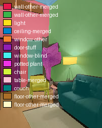

## 2. Test set buatan sendiri

Test set dibuat dari **40 foto ruangan** yang diambil menggunakan kamera HP pada 23 November 2026. Resolusi sumber 4608×3456. Set ini memiliki 264 poligon pada 12 kategori. Sepuluh gambar ditandai sebagai kondisi sulit: ID 35–39 untuk foto redup dan ID 30–34 untuk sudut ekstrem. Nilai EXIF berbeda antarfoto; jangan menyimpulkan bahwa seluruh foto redup memakai ISO atau exposure yang sama.

| Pemeriksaan | Hasil |
|---|---:|
| Foto | 40 |
| Anotasi poligon | 264 |
| Kategori dengan anotasi | 12 |
| Foto redup | 5 (indeks 35–39) |
| Foto sudut ekstrem | 5 (indeks 30–34) |
| Metadata EXIF | 40/40 memiliki waktu pengambilan dan metadata exposure yang diekspor; kolom model kamera kosong pada CSV |
| Kelas things yang terwakili dalam evaluasi bersama | 8 dari 24 |

Foto sumber 40/40 disertakan di [folder exif_originals](reports/own_test_eval/exif_originals/). Metadata EXIF diekspor ke [exif_metadata.csv](reports/own_test_eval/exif_metadata.csv); file ini memuat nama file, waktu, ISO, exposure, f-number, dan brightness value, tanpa koordinat GPS. Bukti proses anotasi manual tersedia pada screenshot editor Roboflow berikut. Screenshot ini menunjukkan editor dan anotasi, sedangkan montase di bawahnya memberi konteks seluruh foto; keterbacaan detail anotasi bergantung pada ukuran tampilan gambar.

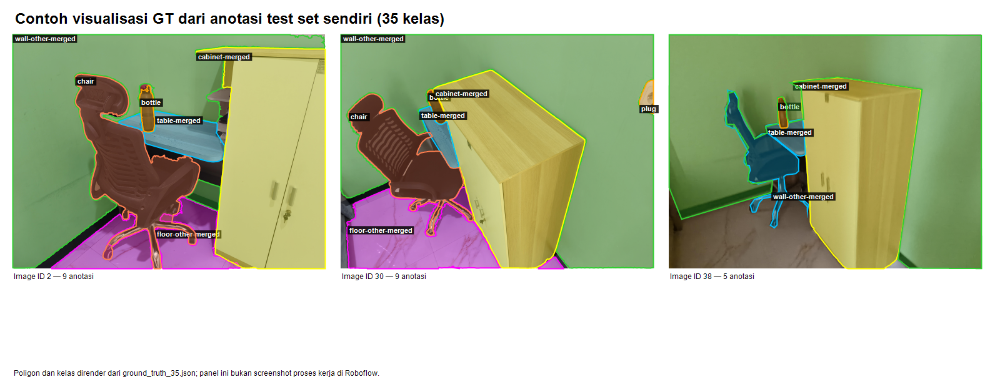

Gambar ini dirender dari anotasi JSON untuk memperlihatkan label dan mask yang tersedia. Screenshot editor Roboflow di atas menjadi bukti proses anotasi manual.

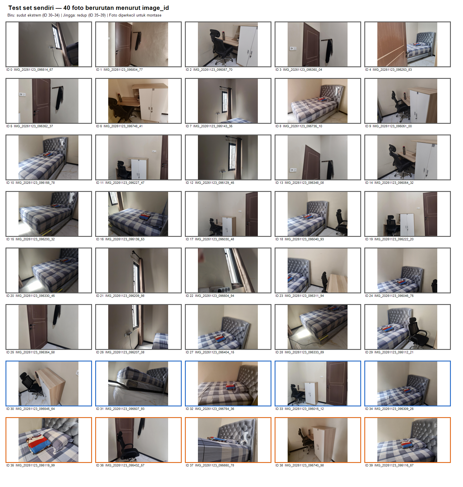

### Catatan cakupan kelas

Walaupun model dilatih dengan 35 kelas, test set sendiri hanya memiliki anotasi things untuk delapan kelas: `bed`, `blanket`, `bottle`, `cabinet-merged`, `chair`, `pillow`, `plug`, dan `table-merged` (120 anotasi things). Enam kategori tambahan dalam 264 anotasi merupakan kelas lain yang tidak dipakai dalam tabel evaluasi things-only. Jadi AP own-test **bukan AP 35 kelas**. Sebanyak 16 dari 24 kelas things tidak muncul pada anotasi set ini; hasil tidak boleh digeneralisasi ke seluruh label space.

Distribusi anotasi pada delapan kelas bersama:

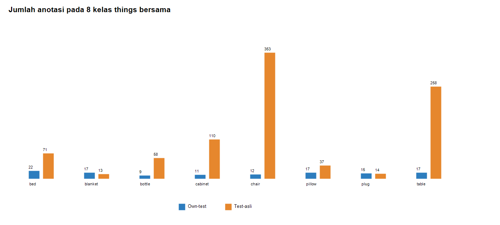

| Kelas | Own-test (40 foto) | Test-asli (359 foto) |
|---|---:|---:|
| bed | 22 | 71 |
| blanket | 17 | 13 |
| bottle | 9 | 58 |
| cabinet-merged | 11 | 110 |
| chair | 12 | 353 |
| pillow | 17 | 37 |
| plug | 15 | 14 |
| table-merged | 17 | 258 |
| **Total anotasi things** | **120** | **914** |

## 3. Hasil evaluasi

### 3.1 Test set sendiri: evaluasi lokal YOLO26m dan ECSeg-L

Tabel ini memakai evaluasi own-test lokal pada maksimum sisi 1280 px; gambar sumber diskalakan proporsional dan input model tetap 640. Hanya anotasi things pada delapan kelas yang memiliki GT yang dievaluasi. Batas maksimum deteksi adalah 100 per gambar.

| Model | Inisialisasi | Mask AP50:95 | Mask AP50 | Mask AP75 |
|---|---|---:|---:|---:|
| YOLO26m-seg | Pretrained | 0,356 | 0,503 | 0,423 |
| YOLO26m-seg | Scratch | 0,103 | 0,165 | 0,115 |
| ECSeg-L | Pretrained | **0,493** | **0,661** | **0,540** |
| ECSeg-L | Scratch | 0,003 | 0,007 | 0,000 |

Angka ini berasal dari evaluasi 40 foto; YOLO dijalankan di RTX 4060 Laptop GPU. YOLO membutuhkan sekitar 15,0 ms/gambar (pretrained) dan 13,1 ms/gambar (scratch), tanpa pembacaan file. Evaluasi ECSeg-L memerlukan sekitar 55 detik untuk keseluruhan 40 gambar termasuk startup dan COCO postprocess, sehingga waktu tersebut bukan latensi inferensi per gambar yang sebanding langsung dengan YOLO. Resolusi asli terlalu besar untuk jalur evaluasi ECSeg pada VRAM 8 GB, sehingga evaluasi memakai salinan maksimum 1280 px.

### 3.2 Perbandingan dua domain pada protokol bersama

Untuk menganalisis perubahan domain, seluruh model dievaluasi ulang pada maksimum sisi 960 px, input model 640 px, 100 deteksi per gambar, dan delapan kelas things yang sama. Own-test berisi 40 foto/120 anotasi; test-asli berisi 359 foto/914 anotasi. Gap didefinisikan sebagai `AP own-test − AP test-asli`; penurunan relatif dihitung terhadap AP own-test.

| Model | Arm | Own-test AP50:95 | Test-asli AP50:95 | Gap AP | Turun relatif |
|---|---|---:|---:|---:|---:|
| YOLO26m-seg | Pretrained | 0,369 | 0,128 | 0,241 | 65,2% |
| YOLO26m-seg | Scratch | 0,104 | 0,011 | 0,093 | 89,4% |
| ECSeg-L | Pretrained | **0,489** | **0,259** | 0,230 | **47,0%** |
| ECSeg-L | Scratch | 0,003 | 0,000 | 0,003 | 100,0%* |
| Swin-L + Mask2Former | Pretrained | 0,300 | 0,145 | 0,154 | 51,5% |
| Swin-L + Mask2Former | Scratch | 0,000 | 0,000 | 0,000 | — |
| EVA-02-L + Cascade Mask R-CNN | Pretrained | 0,324 | 0,141 | 0,182 | 56,4% |
| EVA-02-L + Cascade Mask R-CNN | Scratch | 0,0019 | 0,0003 | 0,0016 | 83,1% |

\* Persentase 100% pada ECSeg-L scratch berasal dari nilai yang dibulatkan menjadi 0,000 pada test-asli; jangan menafsirkannya sebagai estimasi presisi tinggi.

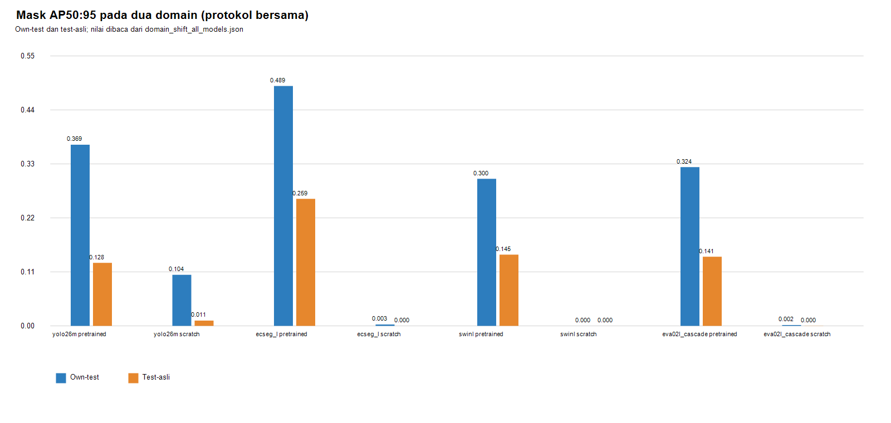

**Interpretasi.** Semua model pretrained mendapat AP lebih rendah pada test-asli. Di antara arm pretrained, ECSeg-L menunjukkan gap relatif terkecil (47,0%), disusul Swin-L (51,5%), EVA (56,4%), dan YOLO26m (65,2%). Pola ini konsisten dengan generalisasi yang lebih sulit pada test-asli, tetapi tidak mengisolasi penyebab visual. Domain test berbeda dalam foto, komposisi kelas, frekuensi kelas, dan kemungkinan gaya anotasi. AP lintas framework juga memiliki perbedaan evaluator: YOLO memakai Ultralytics, sedangkan model lain memakai COCOeval. Karena itu, ranking absolut lintas keluarga perlu dibaca hati-hati.

Perubahan AP50/AP75 membantu membedakan kegagalan lokalisasi mask dari deteksi kasar:

| Model | Arm | AP50 own → asli | AP75 own → asli |
|---|---|---:|---:|
| YOLO26m | Pretrained | 0,524 → 0,228 | 0,441 → 0,121 |
| YOLO26m | Scratch | 0,164 → 0,021 | 0,116 → 0,010 |
| ECSeg-L | Pretrained | 0,670 → 0,402 | 0,537 → 0,262 |
| ECSeg-L | Scratch | 0,007 → 0,000 | 0,000 → 0,000 |
| Swin-L + Mask2Former | Pretrained | 0,435 → 0,239 | 0,329 → 0,148 |
| Swin-L + Mask2Former | Scratch | 0,000 → 0,000 | 0,000 → 0,000 |
| EVA-02-L + Cascade | Pretrained | 0,581 → 0,288 | 0,320 → 0,131 |
| EVA-02-L + Cascade | Scratch | 0,010 → 0,001 | 0,0001 → 0,0005 |

Penurunan AP75 pada arm pretrained menunjukkan bahwa perbedaan bukan hanya pada keberadaan prediksi; kualitas tumpang tindih mask ikut turun. Nilai kecil dan pembulatan pada arm scratch membuat kesimpulan per kelas/domain sangat tidak stabil.

### 3.3 Hasil validasi training

Nilai berikut adalah hasil validasi yang tercatat pada checkpoint/run masing-masing, bukan hasil evaluasi pada satu split identik. Nilai ini berguna untuk menunjukkan hasil eksperimen pretrained-vs-scratch dalam keluarga model yang sama.

| Model | Arm pretrained | Arm scratch | Catatan protokol |
|---|---:|---:|---|
| YOLO26m-seg | mask mAP50:95 **0,3347**, ep24 | **0,1016**, total 144 ep dari warm restart berantai | Scratch mendapat epoch dan waktu lebih banyak; bukan resume optimizer sejati |
| ECSeg-L | segm AP **0,4450**, ep35 | **0,004737**, ep28 | Batch 2; scratch dihentikan setelah 30 epoch dijadwalkan/28 epoch tercatat |
| Swin-L + Mask2Former | mask AP **0,3265**, best ep51 | **0,000747**, best ep45 | Pretrained early-stop ep75; scratch dihentikan manual ep68 |
| EVA-02-L + Cascade | mask AP **0,322801**, ep40 | **0,016784**, best ep20 | Pretrained 40/40; scratch 34/120 dan dihentikan manual |

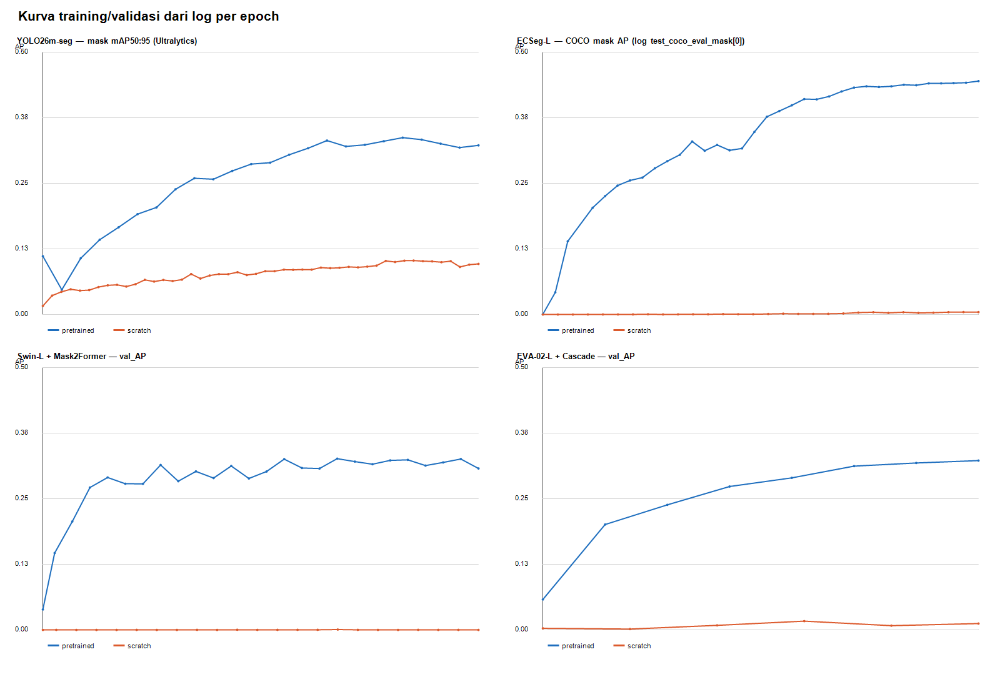

Grafik menggabungkan metric AP yang dicatat tiap epoch: mAP mask Ultralytics untuk YOLO, COCO mask AP untuk ECSeg-L, serta val_AP dari log Modal untuk Swin-L dan EVA. Metriknya berasal dari evaluator/protokol validasi masing-masing, sehingga kurva hanya dibaca di dalam run yang sama; nilai tidak dibandingkan sebagai metrik identik lintas model.

Perbandingan internal menunjukkan manfaat kuat dari pretrained pada data yang terbatas. Akan tetapi, besar gap tidak boleh ditafsirkan sebagai efek pretrained yang terisolasi sempurna: jumlah epoch berbeda, beberapa scratch belum konvergen atau dihentikan manual, prosedur pelatihan dan sumber bobot awal berbeda, dan YOLO scratch memakai warm restart dari bobot tetapi bukan state optimizer. Angka YOLO, ECSeg, Swin, dan EVA berasal dari metrik validasi yang berbeda, sehingga jangan menyusun ranking lintas model dari tabel ini.

## 4. Variabel eksperimen berdasarkan NRP

Digit terakhir NRP adalah **5**. Pada tabel tugas di slide 30 PDF kuliah, digit **4–5** dipetakan ke variabel **dengan vs tanpa pretrained weights**. Untuk menguji variabel ini, hasil validasi terbaik dari tiga keluarga model diringkas di bawah. Nilai berasal dari checkpoint/run yang tersedia, bukan training ulang khusus dengan anggaran identik.

| Model | Keluarga | Dengan pretrained | Tanpa pretrained (scratch) | Selisih AP | Rasio AP* | Catatan run |
|---|---|---:|---:|---:|---:|---|
| YOLO26m-seg | One-stage CNN | 0,3347 | 0,1016 | +0,2331 | 3,3× | Pretrained ep24; scratch terpilih 144 epoch kumulatif dari warm restart berantai |
| ECSeg-L | Transformer/query | 0,4450 | 0,004737 | +0,4403 | 93,9× | Pretrained ep35; scratch ep28 tercatat |
| Swin-L + Mask2Former | Transformer | 0,3265 | 0,000747 | +0,3258 | 437,1× | Pretrained ep75; scratch dihentikan manual ep68 |

Metrik yang dibandingkan adalah AP mask validasi terbaik yang dicatat untuk tiap keluarga. Nilai AP tercetak dengan presisi sumber; rasio dibulatkan satu desimal dan hanya deskriptif. Evaluator/konfigurasi validasi dan sumber bobot pretraining berbeda antar-keluarga, jadi perbandingan yang lebih dapat dipertanggungjawabkan adalah **di dalam tiap pasangan model**.

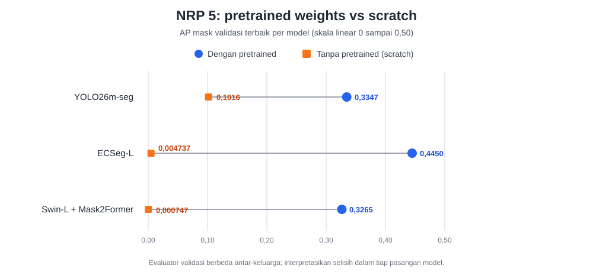

**Hasil.** Arm pretrained mencatat AP lebih tinggi pada ketiga model. Selisih absolut terbesar pada nilai yang tersedia adalah ECSeg-L (+0,4403), tetapi rasio terbesar muncul pada Swin-L karena AP scratch-nya sangat dekat nol; rasio itu tidak stabil dan bukan ukuran efek yang baik. Temuan ini mendukung bahwa bobot pretrained membantu pada eksperimen yang dilakukan, tetapi belum mengisolasi efek pretraining secara sempurna: jumlah epoch, early stopping/penghentian manual, sumber pretraining, dan prosedur restart berbeda. Secara khusus, run YOLO scratch merupakan rangkaian warm restart, bukan resume optimizer setara.

| Batas interpretasi | Dampak |
|---|---|
| Anggaran epoch/waktu tidak sama | AP checkpoint terbaik tidak mengukur perlakuan pretrained saja dengan kontrol penuh |
| Sumber pretrained berbeda | Efek yang diamati adalah pretrained dari sumber masing-masing model, bukan satu sumber bersama |
| Scratch Swin dan EVA berhenti sebelum jadwal awal selesai | AP scratch bisa mencerminkan run yang belum konvergen |
| Evaluator validasi berbeda antar-keluarga | Jangan gunakan tabel ini untuk ranking absolut model lintas arsitektur |

EVA-02-L juga memiliki pasangan pretrained/scratch dan ditampilkan pada tabel validasi §3.3; tiga keluarga di atas dipilih sebagai set ringkas yang mencakup one-stage dan transformer.

## 5. Hipotesis sebelum eksperimen dan evaluasi setelah hasil

Hipotesis dicatat di awal `LOGBOOK.md` dengan tanggal **15 November**. Bukti timestamp yang memastikan catatan tersebut dibuat sebelum training tidak tersedia, sehingga hipotesis diperlakukan sebagai rekonstruksi berdasarkan artefak dan kronologi proyek, bukan sebagai praregistrasi yang terverifikasi.

Ringkasan hipotesis dan hasil yang dapat dievaluasi dari artefak:

| Hipotesis | Alasan saat dirumuskan | Hasil yang tersedia | Status |
|---|---|---|---|
| Pretraining paling membantu ketika jumlah data latih kecil | Backbone/head pretrained membawa fitur dan prior kelas yang sulit dipelajari dari ratusan gambar | Semua keluarga memiliki skor pretrained lebih tinggi; misalnya ECSeg-L 0,4450 vs 0,004737 dan YOLO26m 0,3347 vs 0,1016 pada validasi masing-masing | Didukung pada eksperimen ini; protokol arm tidak identik |
| ECSeg-L akan menunjukkan gap besar antara warm start dan scratch | Backbone transformer kompak mendapat representasi pralatih; scratch harus mempelajari fitur dan pemetaan mask dari sedikit data | Gap validasi 0,4450 vs 0,004737 | Didukung; bukan klaim universal |
| Kelas kecil/tipis lebih rentan gagal | Resolusi representasi mask/prototype yang terbatas dapat menghilangkan detail halus | Kelas tipis/kecil lemah pada beberapa hasil; hubungan mekanistik belum diuji langsung untuk lima foto | Belum cukup bukti; perlukan eksperimen resolusi/representasi |
| Foto redup dan sudut ekstrem menyebabkan gap domain terbesar | Noise, blur, perspektif, dan perubahan skala dapat mengubah fitur objek | Ada 10 foto sulit berdasar EXIF/kondisi pengambilan; tabel domain shift belum memisahkan kinerja tiap kondisi | Belum diuji secara terisolasi |

## 6. Analisis lima kasus kegagalan ECSeg-L

Lima kasus dipilih dari foto own-test berdasarkan GT things yang gagal dipasangkan dengan prediksi pada ambang IoU 0,50. Prediksi dan panel memakai ECSeg-L pretrained. Angka “failed GT” adalah hitungan anotasi yang tidak mempunyai prediksi sekelas dengan IoU minimal 0,50; bukan jumlah false positive.

| Kasus | Foto / image ID | Kelas GT gagal | Gagal / GT things | IoU terbaik same-class | Diagnosis dari kriteria notebook |
|---|---|---|---:|---:|---|
| 1 | `IMG_20261123_095054_328...jpg` / 14 | bottle (2 anotasi) | 2/4 | 0,000 | Kandidat mask overlap ditemukan, tetapi kelasnya salah |
| 2 | `IMG_20261123_095545_640...jpg` / 30 | bottle | 1/5 | 0,000 | Kandidat mask overlap ditemukan, tetapi kelasnya salah |
| 3 | `IMG_20261123_095057_707...jpg` / 2 | table-merged | 1/5 | 0,065 | Miss / near-miss: tidak ada prediksi sekelas dengan IoU ≥ 0,10 |
| 4 | `IMG_20261123_095227_470...jpg` / 11 | table-merged | 1/6 | 0,085 | Miss / near-miss: tidak ada prediksi sekelas dengan IoU ≥ 0,10 |
| 5 | `IMG_20261123_095143_354...jpg` / 7 | plug | 1/3 | 0,185 | Mask sekelas ada, tetapi IoU masih di bawah 0,50 |

Kasus dipilih oleh kode notebook dari GT things yang gagal dipasangkan, diurutkan berdasarkan jumlah kegagalan lalu IoU same-class terendah. Prediksi disaring pada skor ≥ 0,05; sebuah GT dihitung match bila assignment sekelas mencapai IoU ≥ 0,50. Label “wrong-class candidate” berarti ada mask prediksi kelas lain dengan IoU ≥ 0,50, bukan bukti bahwa kelas-kelas itu secara visual mirip. Untuk kasus miss/near-miss, IoU terbaik same-class di bawah 0,10. Lima panel memperlihatkan semua anotasi GT yang tersedia pada gambar, sedangkan hitungan kegagalan tabel ini khusus anotasi things.

### Panel foto, GT, dan prediksi

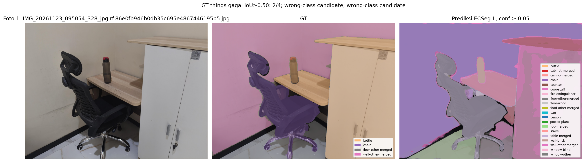

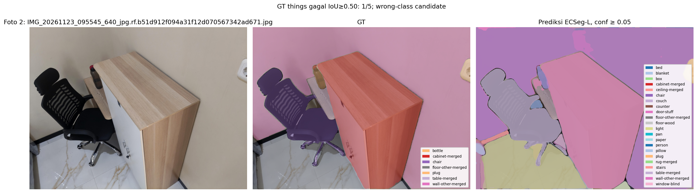

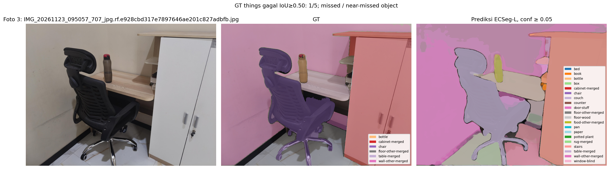

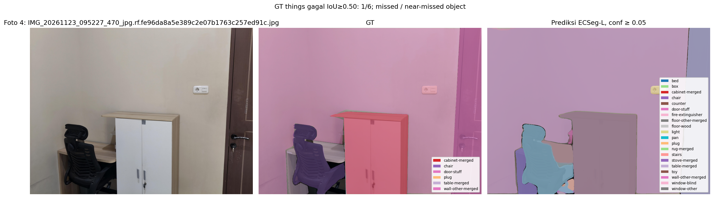

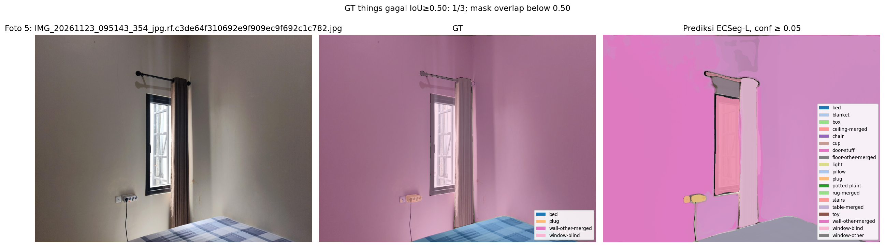

### Interpretasi mekanisme dan uji kecil

Kasus 1 dan 2 menunjukkan bahwa area kandidat tersegmentasi, tetapi prediksinya tidak cocok kelas dengan GT bottle; ini merupakan kegagalan klasifikasi semantik, bukan sekadar tidak menemukan foreground. Kasus 3 dan 4 memiliki IoU same-class terbaik di bawah 0,10 untuk GT table-merged, konsisten dengan objek yang terlewat atau hampir terlewat. Pada kasus 5, GT plug adalah objek kecil di area stopkontak; rerata IoU same-class terbaik hanya 0,185, sehingga kesalahan beberapa piksel atau mask parsial dapat berdampak besar. Ini dugaan mekanistik yang sesuai dengan gambar dan angka, bukan bukti penyebab tunggal.

Eksperimen kecil di notebook menjalankan ulang checkpoint ECSeg-L pretrained yang sama pada lima foto terpilih dengan ukuran transformasi 640×640 (`square_640`) dan 480×640 (`native_480x640`). Skor prediksi tetap disaring pada 0,05, dan kriteria match tetap IoU same-class ≥ 0,50. Hasil lengkap dari `aspect_experiment.csv`:

| Image ID | GT things | Match square → native | Gagal square → native | Rerata IoU same-class untuk GT gagal, square → native |
|---:|---:|---:|---:|---:|
| 2 | 5 | 4 → 5 | 1 → 0 | 0,0651 → — |
| 7 | 3 | 2 → 2 | 1 → 1 | 0,1854 → 0,1905 |
| 11 | 6 | 5 → 5 | 1 → 1 | 0,0849 → 0,0873 |
| 14 | 4 | 2 → 2 | 2 → 2 | 0,0000 → 0,0000 |
| 30 | 5 | 4 → 5 | 1 → 0 | 0,0000 → — |

Tanda — berarti tidak ada GT gagal pada kondisi native sehingga rerata IoU kegagalan tidak terdefinisi. Pada foto 2 dan 30 jumlah miss turun dari satu menjadi nol; tiga foto lain tidak berubah dalam jumlah match. Perubahan ini mengubah ukuran transformasi sekaligus geometri/aspect input, jadi eksperimen belum memisahkan pengaruh resolusi dari pengaruh aspect ratio. Sampel lima foto juga hanya mendukung kesimpulan deskriptif.

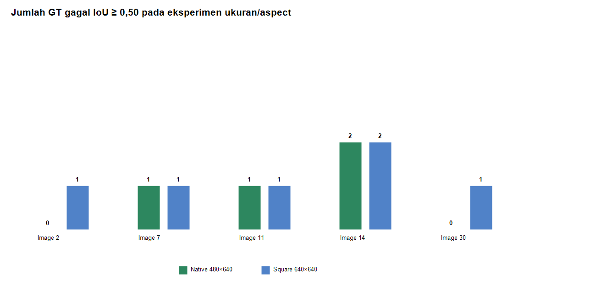

Tabel di atas berasal dari [CSV eksperimen aspek/resolusi](reports/own_test_eval/failure_cases_ecseg_l/aspect_experiment.csv); kode dan output eksekusinya tercatat di bagian lima studi kasus pada notebook evaluasi.

## 7. Bukti proses training dan reproduksibilitas

Artefak proyek mencakup `results.csv`, log training, konfigurasi, metadata metrik, checkpoint terbaik, serta catatan waktu GPU. Training YOLO26m dan ECSeg-L dilakukan di lokal pada RTX 4060 Laptop 8 GB. Swin-L + Mask2Former dan EVA-02-L + Cascade dijalankan di Modal pada GPU L40S; eksekusi Modal dan hasilnya dicatat di notebook/log, bukan dijalankan oleh notebook lokal. Biaya Modal yang tercatat di dokumen sumber: Swin-L pretrained $4,1183; Swin-L scratch $4,3328; EVA pretrained $3,0533; EVA scratch $2,5637. Total harus diverifikasi kembali terhadap billing export sebelum dicantumkan sebagai angka final.

### Augmentasi

Augmentasi dilakukan saat training dan resepnya berbeda antar-model. Konfigurasi YOLO26m mencatat mosaic, horizontal flip, perubahan HSV, scaling, copy-paste, dan RandAugment; mixup serta vertical flip dinonaktifkan. ECSeg-L pretrained memakai mosaic dan mixup sampai epoch augmentasi yang ditentukan konfigurasi, sedangkan keduanya dinonaktifkan pada run scratch untuk mengurangi beban memori. Karena konfigurasi augmentasi tidak seragam, hasil pretrained-vs-scratch dan perbandingan lintas model juga dipengaruhi resep augmentasi masing-masing. Rincian konfigurasi per run dapat diperiksa di notebook training dan berkas konfigurasi/log yang dirujuk pada tabel bukti.

Artefak bukti run mencakup CSV metrik per epoch, log training, konfigurasi ECSeg-L, metadata run, manifest hash, dan event TensorBoard. Checkpoint tidak diduplikasi pada folder bukti ini.

| Model / arm | Lingkungan | Waktu training tercatat | Bukti/log utama |
|---|---|---:|---|
| YOLO26m pretrained | RTX 4060 Laptop 8 GB | 20,5 menit, 24 epoch | [results.csv](local_runs/k35_m_pf0/results.csv), [train.log](local_runs/k35_m_pf0/train.log), `args.yaml`, `metrics.json` |
| YOLO26m scratch | RTX 4060 Laptop 8 GB | 44,9 menit run terpilih; 144 epoch kumulatif | [results.csv](local_runs/k35_m_sf0_c3/results.csv), [train.log](local_runs/k35_m_sf0_c3/train.log), `args.yaml`; warm restart berantai, bukan resume optimizer |
| ECSeg-L pretrained | RTX 4060 Laptop 8 GB | 2 jam 22 menit, 36 epoch termasuk evaluasi | [log JSON](reports/training_evidence/ecseg_l/pretrained/log.txt), [stdout](reports/training_evidence/ecseg_l/pretrained/stdout.log), config dan TensorBoard |
| ECSeg-L scratch | RTX 4060 Laptop 8 GB | 1 jam 34 menit, 30 epoch dijadwalkan | [log JSON](reports/training_evidence/ecseg_l/scratch/log.txt), [stdout](reports/training_evidence/ecseg_l/scratch/stdout.log), config dan TensorBoard |
| Swin-L + Mask2Former pretrained | Modal L40S | 75 epoch; durasi dinding perlu dirujuk ke log | [results.csv](reports/training_evidence/swin_l_mask2former/pretrained/results.csv), [log Modal](reports/training_evidence/swin_l_mask2former/pretrained/train.log), `metrics.json` |
| Swin-L + Mask2Former scratch | Modal L40S | dihentikan manual pada epoch 68 | [results.csv](reports/training_evidence/swin_l_mask2former/scratch/results.csv), [log Modal](reports/training_evidence/swin_l_mask2former/scratch/train.log), `metrics.json` |
| EVA-02-L + Cascade pretrained | Modal L40S | 40 epoch, sekitar 101–104 s/epoch | [results.csv](reports/training_evidence/eva_cascade_mask_rcnn/pretrained/results.csv), [log Modal](reports/training_evidence/eva_cascade_mask_rcnn/pretrained/train.log), ringkasan dan manifest SHA-256 |
| EVA-02-L + Cascade scratch | Modal L40S | dihentikan manual pada epoch 34/120 | [results.csv](reports/training_evidence/eva_cascade_mask_rcnn/scratch/results.csv), [log Modal](reports/training_evidence/eva_cascade_mask_rcnn/scratch/train.log), ringkasan dan manifest SHA-256 |

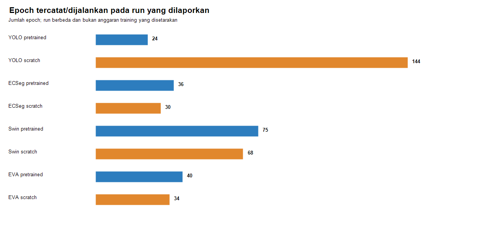

Grafik ini merangkum epoch run, bukan durasi training atau anggaran komputasi yang setara.

## 8. Penggunaan AI

**Deklarasi penggunaan AI.** AI generatif digunakan untuk membantu menulis dan memperbaiki kode evaluasi, men-debug kesalahan, merangkum metrik/artefak, serta menyusun draf laporan. Pemilihan eksperimen, pemeriksaan hasil, dan keputusan akhir dilakukan oleh penulis dengan merujuk pada notebook, log, data, dan artefak proyek. Teks laporan dan kode keluaran AI diperiksa serta disesuaikan sebelum digunakan.

**Prompt utama (dirangkum untuk dokumentasi).**

> Cari model segmentasi instance state of the art yang cocok untuk proyek ini, lalu tentukan mana yang memungkinkan dilatih dengan dataset dan sumber daya komputasi yang tersedia. Cari kode training resmi sebagai acuan dan bantu susun implementasi serupa yang sesuai dengan proyek. Bantu siapkan evaluasi pretrained dan scratch pada test set asli serta test set sendiri, analisis perbedaan hasil dan domain shift, lalu periksa kasus kegagalan berdasarkan gambar dan metrik. Gunakan bukti dari sumber, notebook, dan log; jangan mengarang hasil atau menyatakan dugaan sebagai fakta.

Contoh saran/kesimpulan yang tidak cocok dan koreksinya:

| Saran/kesimpulan awal | Masalah yang ditemukan | Koreksi berbasis bukti |
|---|---|---|
| Menetapkan foto sulit dari persentil kecerahan | Persentil bawah/atas selalu memilih proporsi tertentu, bukan membuktikan kondisi sulit | Gunakan kondisi pengambilan yang dicatat dan periksa EXIF per foto; nilai exposure bervariasi, jadi tidak menggeneralisasi satu nilai ke semua foto redup |
| Membaca EXIF hanya dari IFD utama lalu menyimpulkan metadata kosong | Banyak atribut exposure tersimpan pada sub-IFD EXIF | Baca sub-IFD; 40/40 file memiliki metadata yang diperlukan |
| Mendiagnosis training lambat sebagai pagefile/memory leak | Itu gejala; penggunaan GPU shared tinggi membuktikan spill VRAM via WDDM | Ukur dedicated/shared GPU memory dan bandingkan per-epoch |
| Mematikan mosaic dengan `mosaic_epoch: 0` pada ECSeg | Parameter tersebut mengatur fase flat LR, bukan sekadar peluang mosaic | Matikan dengan `mosaic_prob: 0`; pertahankan `mosaic_epoch`/flat phase |

Kasus paling jelas untuk dipaparkan adalah salah diagnosis kondisi redup: kesimpulan dari brightness piksel bertentangan dengan metadata exposure, dan diperbaiki setelah membaca nilai EXIF sensor secara benar. Tabel metadata yang mendukung pemeriksaan ini tersedia pada [exif_metadata.csv](reports/own_test_eval/exif_metadata.csv).

## Sumber artefak utama

- Notebook training dan evaluasi yang ditempatkan di root repo: `Training Model.ipynb`, `Evaluasi Model.ipynb`.
- Evaluasi dan domain shift lokal/modal: [domain_shift_summary.json](reports/own_test_eval/domain_shift_summary.json) dan [domain_shift_all_models.json](reports/own_test_eval/domain_shift_all_models.json).
- Hasil YOLO 35 kelas dan detail protokol: tabel hasil di laporan ini, notebook training, serta berkas metrik di `local_runs/`.
- Logbook keputusan dan kronologi: `logbook.md` di root proyek.
- Lima gambar kasus kegagalan ECSeg-L disertakan di `reports/own_test_eval/failure_cases_ecseg_l/`.

